<p align="center">
  <a href="https://sonugoswami.netlify.app/">
    
  </a>
</p>

<p align="center">
  <a href="https://sonugoswami.netlify.app/"></a>
  <a href="https://www.linkedin.com/in/sonugoswami1/"></a>
  <a href="https://www.salesforce.com/trailblazer/sonugoswami"></a>
</p>

### Hi, I'm Sonu

I take on the Salesforce work that's hard to get right. Async processing that can't drop a record. Integrations that recover when a callout fails. Business logic where a wrong number costs someone real money.

I'm a **Senior Salesforce Developer**, 4x Salesforce Certified including **Platform Developer II**, and I've spent most of the last four years inside complex, high-stakes orgs in lending and financial services.

### Systems I've built

All in one production Salesforce org for a US private lender, from first loan request through closing, sale and servicing.

| System | What it does | How it's built |
| :-- | :-- | :-- |
| **AI document intake & auto-allocation** | Borrowers and brokers upload a pile of files; each one lands on the right loan checklist item | `Batch(5) → S3 → AI classify → Queueable → LWC review` |
| **Closing document engine, two vendors** | Closing packages generated straight from loan, borrower and property data | OAuth client credentials, payload mapping, version diff before regeneration |
| **Loan sale settlement & QuickBooks engine** | Balanced debit and credit lines for every whole-loan sale | Per-investor day count (actual/360 vs 30/360), pool variance approvals |
| **Loan pricing & term sheet platform** | Bridge, ground-up and term pricers that turn a deal into a term sheet | LWC pricers + external sizing API, repricing flags on guideline changes |
| **Layered entity ownership** | Follows ownership through LLCs owned by other LLCs | Per-loan snapshots, 100% validated at every layer, look-through rollups, approval gate |
| **Paystring engine & investor rollups** | Month-by-month payment history and live investor totals | Legacy history for 4,000+ loans merged with monthly status, event-driven rollups + nightly job |

<sub>Also shipped: Do-Not-Use screening sync · draw & holdback QuickBooks lines · rate lock and cash-out letter PDFs · record-sharing models · production data fixes across tens of thousands of records</sub>

### How I build

```bash
$ sf project deploy validate --test-level RunSpecifiedTests
✓ 91/91 tests passed   coverage per class ≥ 75%
$ sf project deploy quick --job-id 0Af…
✓ Deployed. Mirrored to UAT.
→ data fix: backup written, scope proven, rollback ready
```

- Governor limits shape the design from day one
- Bulk-path tests with 200 records, not one
- Backups and a rollback script before any production data change
- Org state verified after every deploy, even a cancelled one

### Certifications

<p>
  
  
  
  
</p>

### Toolbox

<p>
  
  
  
  
  
  
  
  
  
  
  
  
  
  
</p>

<p align="center"><b>Got a hard Salesforce problem?</b> <a href="https://www.linkedin.com/in/sonugoswami1/">Message me on LinkedIn</a></p>
